# Ahmed Ouazzani

**Data Analytics · Data Engineering · Machine Learning & Applied AI**  
Ottawa, Ontario, Canada | English · French · Arabic

[Portfolio](https://portfolio-9o9p.onrender.com/) · [LinkedIn](https://www.linkedin.com/in/ahmed-ouazzani-5b078b205/) · [Email](mailto:ahmedouazzani225@gmail.com)

## About

Software engineering graduate with postgraduate training in business intelligence and project management. I build practical data systems—from data acquisition and validation to SQL models, Power BI reporting, forecasting, and evidence-grounded AI prototypes.

My background spans business intelligence internships, a municipal client capstone, Python/SQL data pipelines, and reproducible machine-learning experiments. I am pursuing **data analyst, BI developer, data engineer, analytics engineer, data scientist, and applied AI** opportunities in Canada.

## Selected work

| Project | What it demonstrates | Current scope |
| --- | --- | --- |
| [Toronto Air Quality Forecasting](https://github.com/AhmedOT22/Air-Quality-Forecasting) | Python ETL, source-quality checks, chronological model evaluation, Ridge forecasting, scheduled refresh and monitoring | Station-specific reconstructed AQI. On the 2025 evaluation, the selected model reduced MAE against persistence by **27.0% at day 1** and **25.7% at day 7**; this is retrospective, not a live accuracy guarantee. |
| [Hospital Insights Dashboard](https://github.com/AhmedOT22/Hospital-Insights-Dashboard) | SQL Server schema and constraints, reproducible synthetic data, Power BI/DAX, reconciliation and report design | Five-page report project built with **synthetic data**; Power BI Desktop visual/DAX acceptance remains pending. |
| **Procurement Contract Analysis** | React, FastAPI, cited PDF review, optional local LLM integration, acquisition ETL and a separate PostgreSQL research warehouse | **Private, local prototype.** Manual evidence review works; reliable semantic extraction and approved contract pricing are not complete. See the [portfolio](https://portfolio-9o9p.onrender.com/) for an overview. |

### Additional projects

- [Loan Eligibility Prediction](https://github.com/AhmedOT22/Loan-Eligibility-Prediction) — scikit-learn classification, leakage-aware preprocessing, repeated cross-validation, baseline comparison and a Streamlit interface.
- [Real Estate Price Estimation](https://github.com/AhmedOT22/Real-Estate-Price-Estimation) — regression benchmarks on historical property records; limitations and serving-version differences are documented.
- [Amazon Sales Analysis](https://github.com/AhmedOT22/Amazon-Sales-Analysis) — Power BI report and Python-based exploratory notebooks.
- [Mall Customer Segmentation](https://github.com/AhmedOT22/Mall-Customers-Segmentation), [Graduate Admission Classification](https://github.com/AhmedOT22/UCLA-Admission-Prediction) and [Stock Watcher](https://github.com/AhmedOT22/Stock-Watcher-Notebook) — additional educational demos and analysis work.

## Technical focus

- **Data and analytics:** Python, SQL, Pandas, NumPy, Power BI, DAX, Power Query, Excel, KPI design and visualization.
- **Engineering:** ETL/ELT, data validation, data modelling, SQL Server, PostgreSQL, MySQL, Parquet, GitHub Actions, Docker and testing.
- **Machine learning:** scikit-learn, feature engineering, time-series forecasting, chronological validation, baseline evaluation and Streamlit.
- **Applications and AI:** FastAPI, Flask, React, TypeScript, Vue.js, Laravel and local LLM integration with source-evidence checks.

## Experience and education

- **Venizia Inc.** — Business Intelligence & Data Analytics Intern (2025).
- **City of Ottawa / Algonquin College** — team lead, municipal child-care analytics capstone (2025; academic client project, not municipal employment).
- **STE Comised** — Business Intelligence Intern (2022–2023).
- **MyTrade Agency** — Web Development Intern (2021).

Education: Graduate Certificates in **Business Intelligence Systems Infrastructure** and **Project Management** (Algonquin College), and a **Bachelor of Software Engineering** (ESISA).

## GitHub activity

